# Job Application Assistant — Initial Implementation Plan

Status: proposed plan, 27 October 2026. The repository currently contains documentation only. See [FEASIBILITY.md](FEASIBILITY.md) for integration evidence and limitations.

## 1. Product scope

Build a personal job-search workspace that turns preferences and an existing CV into ranked opportunities, tailored application packages, and a reliable history.

The user should be able to:

1. Define roles, locations, remote preferences, languages, contract types, start dates, salary expectations, and exclusions.
2. Supply verified experience, skills, education, links, and an Overleaf LaTeX project export.
3. Import or discover opportunities and review fit explanations and missing information.
4. Generate a custom CV and motivation letter, compare changes, and preview PDFs.
5. Approve a package, submit through a supported channel or apply manually, and preserve the exact submitted files.
6. Track confirmations, responses, interviews, rejections, withdrawals, and follow-ups.

For alternances and internships, capture school enrollment, placement agreement requirements, contract duration, and alternance rhythm where relevant. Never infer eligibility from a CV alone.

Campaign settings distinguish listings scanned, packages generated, and applications submitted. Define separate targets and daily caps; stop or report insufficient matches rather than lowering hard requirements silently.

## 2. Initial technical choices

Use separate `frontend/` and `backend/` directories. The backend is Python, managed with `uv`; the first implemented module is `backend/jobs/`. Choose frontend tooling when dashboard work begins. Use containerized LaTeX tooling for rendering. Keep domain logic independent of AWS handlers and provider adapters.

| Responsibility | Proposed AWS service | Reason |
| --- | --- | --- |
| Static dashboard | Private S3 origin + CloudFront | Simple hosting for a client-rendered application. |
| User authentication | Cognito | Managed sign-in; disable public registration initially. |
| API and short background tasks | API Gateway HTTP API + Lambda | Suitable for intermittent requests and event processing. |
| Primary database | Aurora DSQL, single Region | Relational history, flexible queries, unique constraints, and minimal capacity management. |
| Files | Private S3 buckets | Template versions, source snapshots, generated PDFs, and submission evidence. |
| Multi-step preparation | Step Functions Standard | Coordinate model calls and container tasks with visible execution history. |
| Work buffering | SQS + dead-letter queues | Backpressure and bounded worker concurrency. |
| LaTeX compilation | On-demand ECS Fargate tasks | Package the TeX toolchain and isolate each compilation. |
| Scheduling | EventBridge Scheduler | Source refresh, email synchronization, and reminders. |
| LLM inference | Amazon Bedrock | Configurable inexpensive and stronger model tiers. |
| Credentials and operations | Secrets Manager, KMS, CloudWatch | Token protection, encryption, metrics, and alerts. |

Aurora DSQL is the primary recommendation because users, postings, applications, documents, and events form an evolving relational model. DynamoDB is a credible alternative if access patterns become fixed key-based lookups; do not choose it solely for hypothetical agent scale. If PostgreSQL extensions become necessary, reassess Aurora PostgreSQL. Validate DSQL driver/ORM compatibility and transaction behavior before committing to a migration tool. [DSQL overview and Regions](https://docs.aws.amazon.com/aurora-dsql/latest/userguide/what-is-aurora-dsql.html).

Choose an EU Region supported by the selected services and models. Paris is a candidate, not an assumed universal fit. Review Bedrock inference-profile destinations explicitly: EU hosting alone does not guarantee every model call stays in the same Region. [Inference-profile documentation](https://docs.aws.amazon.com/bedrock/latest/userguide/inference-profiles-support.html).

Use ordinary workflow functions calling Bedrock initially. A managed agent runtime is optional later; parallel tasks do not require autonomous agent loops. Standard workflows support durable orchestration, but external submissions still require application-level reconciliation. [Workflow types](https://docs.aws.amazon.com/step-functions/latest/dg/choosing-workflow-type.html).

```mermaid
flowchart TD
    U[Dashboard] --> API[Authenticated API]
    API --> DB[(Application database)]
    I[Imports and source adapters] --> N[Normalize and resolve identity]
    N --> DB
    DB --> Q[Preparation queue]
    Q --> W[Preparation workflow]
    W --> B[Bedrock: rank and tailor]
    W --> T[Isolated LaTeX task]
    T --> S[(Private S3 artifacts)]
    W --> R[Review package]
    R --> G[Approval or automatic-policy gate]
    G --> C[Atomic submission claim]
    C --> A[Submission adapter or manual handoff]
    A --> DB
    E[Mailbox sync] --> H[Match and reconcile events]
    H --> DB
```



## 3. Adapter boundaries

Separate discovery from submission: one source may only provide listings, while its destination uses another ATS.

Suggested contracts, expressed as responsibilities rather than production API code:

- `JobSourceAdapter`: capabilities, search with cursor, fetch details, normalize, resolve destination identity.
- `SubmissionAdapter`: inspect required fields, validate supported questions, prepare payload, submit, reconcile outcome.
- `MailboxAdapter`: connect/revoke OAuth, synchronize changes with cursor, fetch selected messages, optionally send.
- `TemplateAdapter`: import exported project, identify template version, optionally synchronize Overleaf Git.
- `ModelGateway`: rank, tailor, classify responses, validate schema, and record usage.

Submission capability must be explicit: `manual`, `assisted_browser`, `authorized_api`, or `email`. Record access requirements, allowed usage, rate limits, and reconciliation support. Return typed failures such as `unsupported_question`, `auth_required`, `rate_limited`, and `outcome_unknown`.

First integrations: pasted job text/URL plus a Greenhouse or Lever listing adapter for selected employer boards. A URL import must fall back to pasted text if fetching is unavailable. Do not promise whole-market search from an employer-board API. Add wider discovery sources only after access is verified.

## 4. Logical data model

| Entity | Important fields |
| --- | --- |
| Applicant/profile version | User ID, verified facts with IDs, preferences, eligibility answers, language. |
| Search campaign | Filters, targets, daily limits, spend budget, mode, paused state. |
| Opportunity | Canonical ID, employer, requisition ID, role, contract, location, lifecycle. |
| Source posting | Provider/account/posting ID, opportunity ID, canonical URL, snapshot key, first/last seen. |
| Fit assessment | Opportunity/profile versions, score, evidence, exclusions, unknowns, model/prompt versions. |
| Document package | Application ID, template/profile/job versions, source/PDF keys, hashes, validation results. |
| Application | Applicant ID, opportunity ID, preparation/submission states, response stage, current package. |
| Approval | Application, package hash, answers hash, job snapshot version, approver or policy version, expiry. |
| Submission attempt | Operation ID, adapter, ownership version, start time, outcome, external receipt/evidence. |
| Application event | Application ID, timestamp, event type, actor, evidence, previous/new state. |
| Email link | Provider message/thread ID, application ID, matching confidence, extracted event. |
| Work item/outbox | Unique operation key, payload reference, delivery status, retry metadata. |

Use database uniqueness for source identities and `(applicant_id, canonical_opportunity_id)`. Reapplication is an explicit reviewed action on the existing application history, not a new campaign bypassing this constraint.

Keep large documents and raw snapshots in S3; store references and hashes in the database. Update current state and append its event in one transaction. Keep application history independently of workflow execution-history retention.

## 5. Duplicate resolution and safe parallel work

### Resolve opportunity identity

1. Deduplicate provider posting IDs within their employer/account namespace.
2. Normalize destination URLs, removing tracking parameters while preserving job identifiers.
3. Link shared employer requisition or ATS IDs across sources.
4. Flag likely duplicates using employer, title, location, contract, and description similarity.
5. Require review for uncertain matches before automatic submission. Similarity alone must not merge separate openings.

Identity merges and submission claims must coordinate transactionally. A merge involving an in-flight or completed application requires reconciliation; it must not silently enable another send. Identity-changing transactions need concurrency-conflict handling. [DSQL concurrency control](https://docs.aws.amazon.com/aurora-dsql/latest/userguide/working-with-concurrency-control.html).

### Coordinate submission

1. Validate the current package, answers, approval/policy, job availability, duplicate status, and remaining caps.
2. Atomically reserve the application and relevant quota; only one worker may move it into `submitting`.
3. Persist an attempt ID before the external call. Pass a stable idempotency key when the destination supports one.
4. Store the receipt and immutable submitted package, then record `submitted`.
5. On ambiguous timeout/crash, record or recover to `submission_unknown`; reconcile against receipts, mailbox, or destination before sending again.

A lease can recover abandoned preparation work. **An expired submission lease is not permission to resend.** Fencing checks prevent stale internal writes but cannot undo an external send. Do not blindly retry non-idempotent submissions, including during workflow redrive or queue replay.

Use an outbox written with the database change to avoid losing work between a commit and queue publication. Queue consumers must tolerate repeated messages. Scale ranking and drafting independently from submission; apply per-provider and per-account concurrency limits.

## 6. Document and model pipeline

1. Import the original Overleaf project and approve a structured fact profile.
2. Apply hard search filters before inexpensive-model scoring.
3. Score role fit with evidence, missing requirements, and uncertainty; let the user adjust weights.
4. Send shortlisted opportunities to the stronger model, requesting structured edits referencing approved fact IDs.
5. Validate claims and render edits into a controlled template; preserve employer names, dates, and qualifications accurately.
6. Compile in a task with no secrets, no network, shell escape disabled, restricted filesystem access, and resource/time limits.
7. Check compilation, page count, extracted text, unsupported claims, and visual layout. Show a PDF preview and content diff.
8. Store immutable source/PDF versions. Any material edit invalidates previous approval.

Do not make arbitrary generated LaTeX the default editing interface. Start with escaped text in known sections. Avoid a vector database or RAG infrastructure for a single small profile; add retrieval only when the evidence collection warrants it.

## 7. Approval, automation, and email

Default mode is manual approval. Approval binds the exact document package, answers, and job version; the backend checks it again at submission.

Automatic mode is opt-in per campaign and supported channel. Require an approved policy covering thresholds, allowed sources/employers, daily caps, maximum spending, and prohibited unknown answers. Missing eligibility information, sensitive declarations, unresolved duplicates, or interactive challenges route to review. Include a global pause switch checked immediately before sending.

Track preparation (`discovered → scored → drafting → review → ready`) separately from submission (`not_submitted → submitting → submitted / submission_unknown / failed`) and employer response (`awaiting_response / interview / rejected / offer / withdrawn`).

Manual handoff downloads the approved package and opens the destination. Record “marked submitted by user” with optional evidence separately from a provider-confirmed receipt. Downloading a PDF is not a submission event.

Connect one mailbox provider first; Gmail is an initial assumption to confirm. Start with read-only incremental sync and selected relevant messages. Match using receipts, requisition IDs, threads, employer, and role; company name alone is insufficient. Deduplicate by provider message ID, retain synchronization cursors, and provide reconnect/backfill behavior. Add email sending separately, through the connected provider, only where the posting accepts email applications.

## 8. Build milestones and acceptance criteria

### Phase 0 — Resolve integration risks

- Obtain the CV export, sample target postings, preferred email provider, AWS Region, and initial spending cap.
- Reproduce the existing PDF in a local container.
- Verify one discovery source and document its submission fallback.
- Benchmark inexpensive/stronger models on about 30 representative French/English postings.

Exit: usable template, verified access assumptions, measured document quality, and a cost worksheet. These are inputs for implementation, not blockers to this planning document.

### Phase 1 — Useful approval-first MVP

- Profile/preferences, manual imports, application database, S3 versioned artifacts, and timeline.
- Ranking, CV/letter generation, validation, PDF preview, and approval.
- Manual submission handoff and explicit user-recorded outcomes.
- Authenticated AWS deployment with private storage and basic alerts.

Exit: complete an end-to-end application package and record its exact submitted version without inventing profile facts.

### Phase 2 — Discovery and mailbox automation

- One listing adapter, scheduled refresh, expiry detection, and canonical identity resolution.
- Read-only mailbox OAuth, incremental sync, suggested status updates, and reminders.

Exit: repeated imports do not duplicate recognized jobs; email events are explainable and ambiguous matches remain reviewable.

### Phase 3 — Selective submission

- Implement one genuinely accessible submission channel; email is an option only for postings that accept it.
- Add transactional reservations, outbox, approval invalidation, receipts, and unknown-outcome recovery.
- Enable opt-in automatic policies only after reliability tests pass.

Exit: concurrent requests produce one outbound attempt for the same known application; simulated lost responses never trigger blind resend.

### Phase 4 — Controlled parallelism

- Separate worker pools, provider limits, spend reservations, backpressure, and dead-letter recovery.
- Additional adapters; optional Overleaf Git sync and permitted browser assistance.

Exit: bounded parallel runs preserve identity, approval, budget, and submission invariants during retries and crashes.

Planning allowance: roughly 4–8 full-time engineering weeks for a narrow personal MVP, including integration spikes; broader site coverage and unattended browser submission have open-ended maintenance costs. This is a scope estimate, not a delivery commitment.

## 9. Repository and verification plan

Proposed layout:

```text
frontend/              dashboard
backend/jobs/          fetching, normalization, adapters, persistence
backend/applications/  approvals, submission, tracking (later)
backend/documents/     tailoring and PDF generation (later)
backend/profile/       applicant facts and preferences (later)
backend/email/         mailbox integration (later)
backend/tests/         automated backend tests
infra/                 AWS infrastructure as code
templates/             non-personal template fixtures
docs/                  design decisions and operational notes
```

Choose one infrastructure tool during implementation; document actual commands once configured. Keep real CVs, mailbox fixtures, credentials, and generated personal artifacts out of Git.

Prioritize meaningful tests: canonical ID mapping, simultaneous claims, duplicate queue delivery, stale approvals, lost responses, identity merging during submission, atomic budget caps, unsupported model claims, LaTeX isolation, mailbox replay, and access across users. Use fake submission adapters for automated tests; never send real applications from CI. Verify compiled PDF layout with realistic fixtures.

Before releasing automatic mode, exercise pause/revoke behavior, backup/restore, retention/deletion, and redacted logs. Record token usage and cost per preparation run. The first implementation task is the vertical slice: **import one job → score → tailor existing CV → compile → review → record manual submission**.
