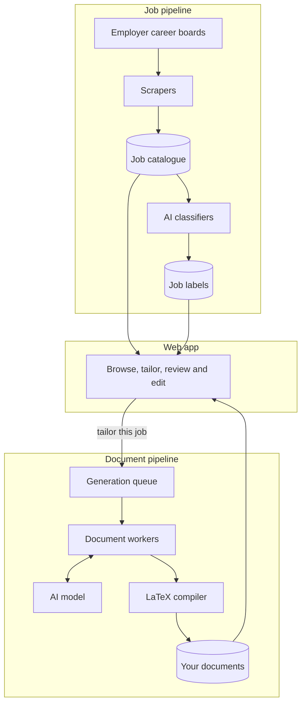

# Job Applier

A job-search assistant for software, AI/ML, DevOps and related roles, including permanent
jobs, internships and alternances.

Job Applier collects job postings directly from employer career boards, labels them so you
can filter them properly, and tailors your own CV and application letters to the job you
choose. You review and edit everything before you use it.

## What it does

**Finds jobs.** It gathers postings from eight applicant tracking platforms: Greenhouse,
Lever, Workday, Ashby, Workable, Recruitee, Rippling and Personio. Postings from all of them
are put into one common format in a single catalogue.

**Understands jobs.** An AI classifier labels each posting by seniority, contract type,
technical relevance and role, so you can filter on what a job actually is rather than on
keywords. A posting is only classified again if its content changes, which keeps the cost
down.

**Tailors your application.** Pick a job, one of your LaTeX CVs, a model and a language
(English or French). The app produces three documents:

- **Your CV**, rewritten for the job in your own LaTeX template, with the job's key terms
  worked in where your real experience supports them
- **A motivation letter**, on why you want this role
- **A cover letter**, on the evidence that you fit it

**Stays truthful.** The model may only use facts from your CV and profile, and it must not
invent experience, skills or numbers. Every rewrite is checked before it is accepted, and
the app shows you exactly what changed in the CV, along with the model's reasons in English.
Nothing is fact-checked automatically, so the final review is yours.

**Lets you finish the job.** You can edit the LaTeX of the CV and both letters directly in
the web app and see the compiled PDF beside the code. Double-clicking the CV preview jumps to
the matching line of code. Each job keeps one entry showing your latest version, and earlier
versions stay in its history.

## How it works

The system has two independent parts, a job pipeline and a document pipeline, with a web app
on top of both.

### Job pipeline

A list of employer boards is split into work items on a queue. Scrapers take items from the
queue, fetch each company's postings and save them to the catalogue. Each new or changed
posting then moves through a second queue to the classifiers, which store their labels
separately from the postings.

Workers run as containers that scale with the queue, and they scale to zero when there is
nothing to do. Collection is started manually for now.

### Document pipeline

When you ask for a tailored CV, your CV, profile and the job are frozen into a snapshot and
queued, so changing your profile later cannot affect a generation already under way. A
document worker sends the snapshot to the AI model, checks the rewritten CV, and compiles
all three documents to PDF. If a rewrite is rejected or fails to compile, the error goes back
to the model, for up to three attempts in total. The sources and PDFs are then stored
against your user and the job.

Your own edits skip all of this. The app compiles what you wrote straight away and saves it
as the new current version, with no queue and no AI model involved.

### Web app

The app is a browser interface backed by an API that reads from both pipelines. It currently
runs locally, with one user, while the pipelines run on AWS.

### Built with

| Area | Technology |
| --- | --- |
| Web app | React, TypeScript and Tailwind |
| API and workers | Python and FastAPI |
| AI | Amazon Bedrock for documents, TypeSafe Jev for job classification |
| Documents | LaTeX |
| Cloud | AWS: ECS Fargate, SQS, DynamoDB, S3, Lambda, defined with CDK |

## Where it is headed

Job Applier is being built step by step. These are not implemented yet:

- Job recommendations for each user
- User accounts and a hosted version of the app
- Submitting applications
- Connecting a mailbox to track responses
- Overleaf sync
- Automatic scheduled collection

Generating a document package does not submit an application.

## Learn more

Setup, deployment and developer guides start at the [documentation map](docs/README.md).
