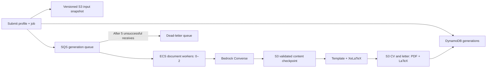

# Tailored CV and motivation letter

Generate an English CV and motivation letter for one saved profile and job.
Requests run asynchronously in the independent `Application` stack.



## Setup and submission

From the repository root:

```sh
uv sync --locked --group infra
cdk diff Application
cdk deploy Application
uv run python -m scripts.seed_profiles --stack Application --region us-east-1
uv run python -m backend.documents generate \
  --user-id demo-user-001 --job-id YOUR_SAVED_JOB_ID --region us-east-1
```

The command resolves table, queue, bucket and model names from CloudFormation
outputs. `--application-stack`, `--jobs-stack`, `--profile` and `--region` override
the defaults. Local AWS credentials need CloudFormation DescribeStacks, profile/job
GetItem, generation GetItem/PutItem, S3 PutObject/GetObject/GetObjectVersion and
SQS SendMessage. The worker has its own narrower task role.

Alternatively pass `--job-file /path/to/job.json`, with this shape:

```json
{"title": "Junior Python engineer", "description": "Build and maintain APIs.", "company": "Example"}
```

A missing `job_id` is derived from the file contents. Use `--job-id` for a stable
link to an existing job. Save the returned `generation_id` to inspect the result:

```sh
uv run python -m backend.documents status \
  --user-id demo-user-001 --generation-id GENERATION_ID --region us-east-1

uv run python -m backend.documents retry \
  --user-id demo-user-001 --generation-id GENERATION_ID --region us-east-1
```

A ready response includes PDF/LaTeX download URLs valid for 15 minutes (or until
the signing credentials expire). URLs are generated on demand and not stored.
`retry` republishes the request; it does not reset a ready result or active lease.
For messages in the DLQ, fix the underlying problem before retrying/redriving.

## Templates and factual content

The default template is `templates/cv.tex`. Pass `--cv-template /path/to/cv.tex`
to supply a **trusted**, self-contained XeLaTeX template. Required placeholders:
`<<NAME>>` and either `<<SECTIONS>>` or `<<RESUME_SECTIONS>>`. Optional placeholders:
`<<CONTACT>>`, `<<HEADLINE>>`, `<<SUMMARY>>`, `<<RESUME_CONTACT>>`.

The supplied Jake Gutierrez resume layout is available as
`templates/jake_resume.tex`:

```sh
uv run python -m backend.documents generate \
  --user-id YOUR_USER_ID --job-id YOUR_SAVED_JOB_ID --region us-east-1 \
  --cv-template backend/documents/templates/jake_resume.tex
```

It preserves the centered header, ruled headings and resume entry/bullet macros,
with wrapping title columns. `<<RESUME_SECTIONS>>` renders education, experience,
projects, technical skills, certificates and languages using this template's
`resume*` macros; a custom template using that placeholder must define the same
macros. `<<RESUME_CONTACT>>` inserts profile contact details and clickable email
and profile links (requires `hyperref`). Empty sections are omitted. Education
locations and skill/certificate categories are not inferred: the current profile
model does not store those fields. The original pdfTeX Unicode commands are
replaced with XeLaTeX/fontspec and Latin Modern Roman. Personal details and career
facts belong in the DynamoDB profile, rather than being fixed in the template.

Images, external template files and Overleaf synchronization are
not supported yet. Template text is currently limited to 10,000 characters.

Bedrock returns structured text, never executable LaTeX. The renderer escapes
text and takes employer names, qualifications and dates from the original
profile. Unknown source IDs and skills are rejected. This checks references,
not the truth of every rewritten sentence: every result is marked
`review_required: true`. No applications are submitted by this feature.
Do not accept arbitrary uploaded LaTeX in a public API without a separate,
credential-free compilation sandbox. Current templates are trusted local assets.

## Storage, retries and concurrency

`DocumentGenerations` uses `(user_id, generation_id)` keys. Each record links the
job ID, profile version, frozen inputs, model/prompt versions and artifact keys
and S3 version IDs. The `ByUserJob` index supports queries using `user_id` and
`begins_with(job_created, "JOB_ID#")`. Generation status is `queued`, `processing`,
`ready` or `failed`; `failed` can still have automatic SQS retries pending.
Failures expose `failure_stage`, `last_error` and a safe `error_detail` through
`status` and worker logs. Diagnostics identify invalid source fields and Bedrock
stop reasons without logging profile facts or raw model responses. When XeLaTeX
fails or times out, its log and failing LaTeX source are stored privately in S3.
`status` returns `downloads.compilation_log` and `downloads.compilation_source`
even for failed generations. These files can contain personal CV text; they are
not included in CloudWatch logs. Diagnostics capture is limited to 2 MB.

The worker image explicitly installs `texlive-fonts-recommended` (including
`marvosym.sty`) and checks that package file during the image build. The current
Jake template no longer imports the unused `marvosym` package; the image retains
support for existing input snapshots that still import it. After deploying this
image fix, retry an existing failed generation to reuse its model-output checkpoint;
editing a local template alone does not change an already frozen request.

Identical inputs reuse a generation; `--force` creates a new revision. A DynamoDB
lease prevents simultaneous processing. Each attempt writes separate artifact
keys. Model output is checkpointed before compilation, so render retries reuse
it. SQS is at-least-once: a crash after a model response but before its checkpoint
can still cause another paid invocation. Submission is not an atomic DynamoDB/SQS
transaction; rerun the identical submission if queue publication fails.

Workers handle one request each, renew queue visibility every minute, and have a
10-minute hard deadline. The lease lasts two minutes longer than that deadline.
After five unsuccessful receives, SQS moves the message to the DLQ; timed-out
records may remain `processing` until a later retry claims the expired lease.
Unused snapshots or failed-attempt artifacts can remain in S3 for later cleanup.

## Development and infrastructure

```sh
uv run python -m unittest backend.tests.test_documents -v
uv run --group infra python -m unittest infra.tests.test_application_stack -v
uv run ruff check backend/documents backend/tests/test_documents.py infra/application_stack.py
docker build --platform linux/amd64 -f containers/Dockerfile.documents -t job-applier-documents:test .
```

Tests mock compilation, AWS and Bedrock. The image installs XeLaTeX; compilation
outside Docker needs XeLaTeX, DejaVu Sans and Latin Modern Roman installed locally.

The document worker image is published to `<lowercase-stack-name>/documents`
(`application/documents` by default). CDK stages the image in its bootstrap
repository, then a deployment-time CodeBuild project copies it before ECS updates.
See [worker image repositories](../../infra/README.md#worker-image-repositories).

The stack defaults to `us.amazon.nova-pro-v1:0`, two maximum workers,
a 600-second deadline, and zero idle workers. Override during deployment:

```sh
cdk deploy Application -c maxDocumentWorkers=4 -c documentTimeoutSeconds=900 \
  -c documentModelId=us.amazon.nova-pro-v1:0
```

Use a model available to your account/region that supports Converse forced tool
use. The current policy supports Nova Pro and Anthropic regional model IDs and
`us.`, `eu.` or `apac.` inference profiles; changing the model requires redeployment.
Rerun `generate` after changing models: queued requests retain their frozen model ID
and cannot be migrated by `retry`. Nova's tool schema is adapted to its supported
root fields; output still passes the same Pydantic and profile-reference validation.
Model access,
provider-specific first-use requirements and cross-region organization policies must be
satisfied before a real run.

The independent VPC has public subnets, no inbound worker access and no NAT
gateway. Running workers use public IPs for AWS API access. Workers receive only
S3 snapshots and generation records, not access to the Profiles or Jobs tables.
The DLQ has a CloudWatch alarm; notification destinations are not configured.
This is a CLI workflow, without authentication or a web API yet. Deploying creates
billable resources; storage tables and the documents bucket are retained on destroy.
