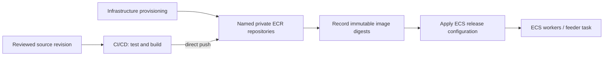

# Plan: Direct CI/CD Publishing to Worker ECR Repositories

**Status:** repository creation, direct-push and tag pinning implemented (see `infra/worker_images.py`); release manifest, CI workflow and bootstrap mode pending.
**Documented:** 2026-10-29.
**Current scope:** documentation only. No Dockerfiles, AWS resources, deployment
scripts or CI workflows are changed by this documentation task.

## Goal and ownership

Infrastructure creates the repositories and runtime resources. A CI/CD runner
builds, tests and pushes images directly to their worker repositories. Images
must no longer pass through CDK's bootstrap repository or a deployment copy job.

| Owner | Responsibilities |
|---|---|
| CDK infrastructure | ECR repositories, IAM, ECS cluster/task/service configuration, queues, tables, buckets, schedules, outputs |
| CI/CD runner | Build/test images, authenticate to ECR, push immutable versions directly, record digests, coordinate release and rollback |
| Runtime workers | Collect/classify jobs or generate documents; no image publication responsibilities |

The CI provider is not selected yet. GitHub Actions, a normal CodeBuild pipeline
or another runner could implement this contract. Removing the current CodeBuild
**copy project** does not prohibit using CodeBuild later as the actual CI runner.

## Current code versus target

| Concern | Current implementation | Target |
|---|---|---|
| Build | `DockerImageAsset` inside `infra/worker_images.py` | CI/CD builds from `containers/` |
| Upload | CDK bootstrap ECR staging | Direct push to the worker repository |
| Copy | Deployment-time CodeBuild project | None |
| Publication coordination | Lambda handlers and asynchronous custom-resource waiter | CI/CD release stages |
| ECS image | Tag returned by `Custom::WorkerImage` | Published image digest from the release manifest |
| Repository ownership | Stack-created ECR resources in `WorkerImages` | Keep infrastructure ownership and existing physical repositories |

`infra/stack.py` and `infra/application_stack.py` currently call this helper.
The target behavior below is **not yet available**. Existing deployment commands
still use the current asset/copy workflow until migration is implemented.

## Repository and release contract

Keep these default names:

| Stack | Worker | Repository | Existing build file |
|---|---|---|---|
| `JobPipeline` | Feeder | `jobpipeline/seed` | `containers/Dockerfile.seed` |
| `JobPipeline` | Scraper | `jobpipeline/scraper` | `containers/Dockerfile.scrape` |
| `JobPipeline` | Classifier | `jobpipeline/classifier` | `containers/Dockerfile.classify` |
| `Application` | Documents | `application/documents` | `containers/Dockerfile.documents` |

Prefix names with the lowercase physical stack name. For example,
`Application-Dev` becomes `application-dev/documents`. Do not rename existing
repositories just to introduce environment suffixes; stage naming needs a separate
migration decision.

Repositories retain immutable image versions. Use a unique traceable build tag,
such as `<git-sha>-<run-id>`, then resolve the pushed image digest. Deploy by digest
rather than a mutable `latest` tag. Preserve versions needed for rollback.

**Proposed release record:** one tracked YAML manifest per environment, such as
`config/releases/dev.yaml`. Do not create this directory until implementing the
manifest reader and workflow. Each worker entry records its repository URI,
`sha256` digest, source revision and build identity. Workers may be released
independently, so do not assume every entry has the same source revision.
Repository URIs are deployment metadata, not credentials; no tokens go in this file.

## One owner for ECS image versions

Proposed default: **CI publishes images, then applies the new release manifest
through CDK/CloudFormation.** CDK reads image references; it never builds, uploads
or copies images. Calling CDK to update ECS after a direct push does not send image
bytes through CDK staging.

Every later infrastructure deployment must read the same current manifest. Missing
or invalid image pins must fail clearly, without silently falling back to `latest`,
a placeholder image or an older built-in version. This prevents an unrelated
infrastructure deployment from restoring an old task image.

Do not also let CI call `ecs update-service` with independently managed task
revisions. If the team chooses that release mechanism instead, first define how
CloudFormation avoids overwriting its state and how the non-service feeder's
manual and scheduled task references are updated. Choose one owner, not both.

## Implementation sequence

### 1. Inventory and preserve the current environment

- Inspect the working tree, stack resources, repository ownership, active task
  definitions and pinned images. The current image changes may or may not have
  been deployed; source alone cannot answer that.
- Record whether collection scheduling or autoscaling has been manually suspended.
  Do not resume either as a side effect of this migration.
- If repositories are already deployed, preserve their construct paths/logical IDs
  or use an explicit reviewed ownership migration. Moving them out of `WorkerImages`
  casually can attempt replacement and collide with retained repository names.
- Preserve existing tables, buckets, queues, clusters, networking and worker IAM
  boundaries. No stack destruction or data reset is part of this plan.

### 2. Make infrastructure consume published images

- Keep ECR creation, immutable tags, repository outputs and worker pull grants.
- Replace asset-produced image references with validated release-manifest digests.
- Remove `DockerImageAsset`, bootstrap-image pull grants, the copy CodeBuild project,
  publisher Lambdas, `Custom::WorkerImage`, waiter and their dedicated IAM/log resources
  once consumers no longer depend on them.
- Remove `ImageCopyProjectName` and `ImageCopyLogGroup` outputs when their resources
  go away; retain the repository URI outputs for CI discovery.
- A small helper for repository creation/image references is acceptable. It must
  not hide another image-building or image-copying pipeline.
- Keep useful Lambda assets such as the DynamoDB stream router. The CDK bootstrap
  stack is still used for other CDK assets; do not delete or rename it.

### 3. Handle first provisioning explicitly

A repository must exist before CI pushes, and a published image must exist before
image-consuming workloads are activated.

- Existing environment: use its infrastructure-owned repositories, push the first
  direct images, then deploy the new pinned references. Keep the old image path
  working until the replacement is ready.
- New environment: provide an explicit provisioning phase that creates repositories
  and supporting resources before image-dependent task definitions/services and
  schedules are enabled. CI then publishes initial images and activates runtime
  resources with valid digests. A guarded bootstrap mode is one implementation option.
- Never implement bootstrap by omitting existing resources from a deployed stack;
  CloudFormation could interpret that as deletion. Bootstrap is for new environments,
  and the workflow must reject accidental use against an active environment.
- Do not use a dummy image or start a service referencing an unpublished tag.

### 4. Implement the CI/CD release stages

1. Select an environment and obtain scoped AWS access using the runner's workload
   identity/OIDC where available; do not store long-lived AWS keys in the repository.
2. Run relevant offline tests and build the affected worker images for the current
   `linux/amd64` runtime. Dockerfile changes are future implementation work, not this task.
3. Verify compilation for the document image using a fictional profile and shipped
   templates, including the LaTeX toolchain. Mocked runtime tests alone are insufficient.
4. Push directly to the named repositories and verify the resulting image digests.
5. Produce/persist the complete release manifest, carrying forward unchanged workers.
6. Review the infrastructure diff, then apply the intended stack's release references.
7. Wait for ECS deployment success. For the feeder, verify the task definition used
   by `infra.manage collect` and the daily rule, not just long-running services.
8. Record the deployed manifest and previous manifest for rollback.

Serialize releases per environment so two contributors cannot publish stale
manifests over each other. A failed build/push must leave the running release
unchanged. If a deployment fails after publication, preserve its image for diagnosis
and reconcile the manifest with the last successful release. Do not classify a
zero-task, idle queue worker as broken solely because its running count is zero.

Changes to shared backend modules, `pyproject.toml` or `uv.lock` may affect multiple
images. CI change detection must account for shared dependencies. Keep a manual
release path for operators; it should use the same manifest/release contract.

### 5. Verify, migrate and remove obsolete machinery

- Test repository names, retention, pull permissions and concrete digest references.
- Test missing pins, malformed digests and wrong environment/repository mappings.
- Replace publisher-specific assertions in `infra/tests/test_worker_images.py` with
  the new infrastructure contracts; retire handler tests when that handler is removed.
- Synthesize without Docker builds or registry writes. Assert no worker Docker image
  assets, copy project, publisher handlers or copy waiter remain in the templates.
- Compare before/after CloudFormation resources and review `cdk diff` for unintended
  replacement, especially named ECR repositories and stateful storage.
- Validate the whole release against an agreed development environment, then test
  rollback to the previous manifest. Runtime processing remains at-least-once.
- Update current-behavior READMEs and the handoff notes only once the
  implementation is real; remove obsolete staging/copy instructions at that point.

## Acceptance checklist

- [ ] CI provider, environment mapping and manifest location are agreed.
- [ ] Infrastructure creates the required repositories before the first push.
- [ ] CI pushes directly to each worker repository; no bootstrap image staging/copy.
- [ ] CDK consumes published references and synthesizes without image builds.
- [ ] One authoritative manifest prevents competing ECS image-version writers.
- [ ] Every ECS service, manual feeder and scheduled feeder uses its intended image.
- [ ] Existing repository ownership and application data survive the migration.
- [ ] Shared-code rebuilds, concurrent releases and failed deployments are covered.
- [ ] Document-image compilation and rollback are verified in development.
- [ ] Runtime documentation matches the completed implementation.

CI provider selection, release manifests and bootstrap support remain implementation
work. This plan does not create any of them and is not authorization to deploy.
