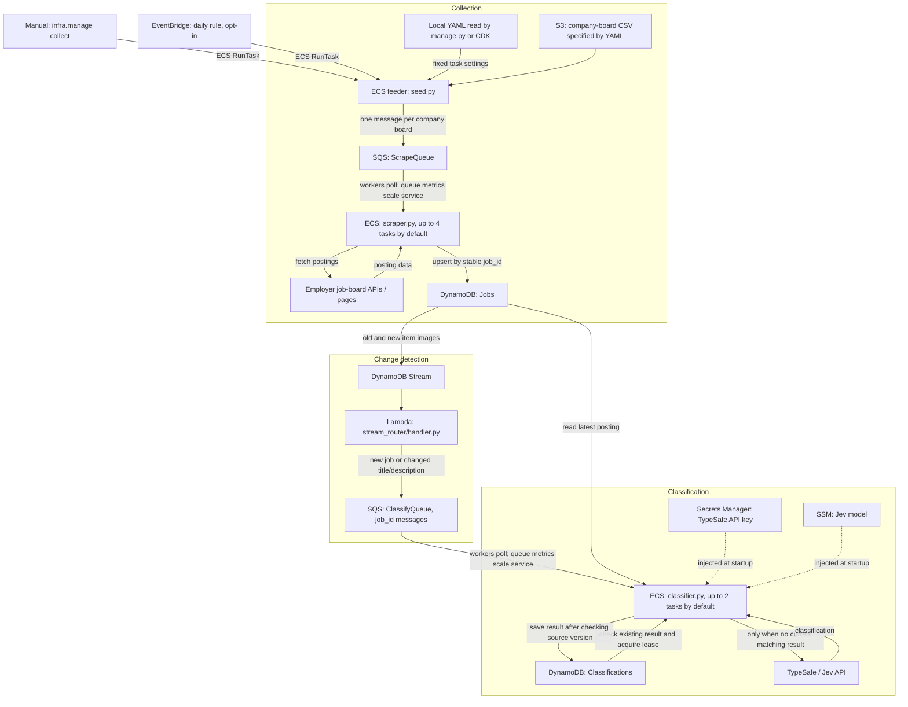
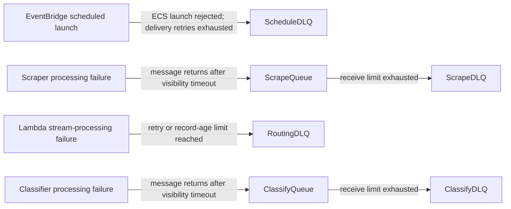

# AWS job pipeline

This CDK application generates a CloudFormation stack containing the complete
collection and Jev classification pipeline. It does not deploy anything merely
by installing dependencies, running tests or synthesizing the template.



The stages overlap: classification can begin while other boards are still being
scraped. Re-scraping a posting updates its existing Jobs item. The Lambda ignores
unchanged titles/descriptions, and classifiers independently skip matching saved
results. Both tables use the same `job_id` to connect postings with classifications.
The YAML stays local. CDK reads it at deployment and stores its values in the
feeder task definition. Every daily run uses those same settings and downloads
only the company-board CSV from S3. Manual launches can read another local YAML.

Each worker processes one message at a time. The default maximum is four scraper
tasks and two classifier tasks; both services start at zero and scale down to zero
after the queue, including in-flight work, empties. Scaling is metric-driven and
takes several minutes; it is not an immediate task launch for every message.
One short-lived feeder task queues the requested company boards. A Lambda routes
new jobs and title/description changes to classifiers. Refreshing only
`last_seen` does not trigger more paid classifications.

Three Dockerfiles build separate images: `containers/Dockerfile.seed` for the feeder,
`containers/Dockerfile.scrape` for scrapers and `containers/Dockerfile.classify` for classifiers. CDK
builds and publishes each image and assigns it to its corresponding task definition.
Each image copies the backend with `COPY backend/ ./backend/` and uses the same
locked Python dependencies. Each has its own entrypoint: `seed.py`, `scraper.py`
or `classifier.py`. Tests are excluded by `.dockerignore`. Company-board data and
launch YAML are not baked into the images. Workers
share SQS polling, visibility renewal and shutdown handling in `workers/runtime.py`.
Fargate manages the machines; there are no EC2 hosts to maintain,
no inbound ports and no load balancer. Tasks use public subnets with public IPs
for outbound employer/API access. Their security group has no inbound rules.
There is no NAT gateway; running tasks still incur public IPv4 charges.

## Infrastructure files and entrypoints

| File | Responsibility |
| --- | --- |
| `infra/app.py` | Creates the CDK app and `JobPipeline` stack, then synthesizes the template. |
| `infra/stack.py` | Defines resources, IAM permissions, task images, scaling and scheduling. |
| `infra/manage.py` | Reads deployed stack outputs to set the API key or launch collection/backfill tasks. |
| `infra/stream_router/handler.py` | Routes new or changed postings from the Jobs stream to classification. |
| `backend/jobs/collection_config.py` | Validates local launch YAML, builds task settings and reads the S3 directory. |
| `backend/jobs/workers/seed.py` | Reads its configured company directory, then queues boards; also supports classification backfill. |
| `backend/jobs/workers/scraper.py` | Consumes board messages, fetches postings and upserts Jobs items. |
| `backend/jobs/workers/classifier.py` | Consumes job IDs, calls Jev when needed and stores results. |
| `backend/jobs/workers/runtime.py` | Shared SQS polling, visibility renewal and graceful shutdown. |

`cdk.json` tells CDK to run `uv run --locked --group infra python -m infra.app`.
`cdk synth` generates CloudFormation; `cdk deploy` publishes assets and asks
CloudFormation to create/update the resources. `CfnOutput` entries expose resource
names and ARNs that `infra.manage` reads after deployment. Running `infra.manage`
does not deploy infrastructure.

## Deploy

Requirements: Python 3.12+, uv, Node.js 22+ (24 recommended), npm, Docker with
BuildKit, and an authenticated AWS account with permission to bootstrap CDK and
create this stack. ECS Fargate and Docker assets target Linux x86-64, including
when deploying from an ARM laptop. Docker must be running during deployment.

From the repository root, select your own account/profile and region, for example:

```sh
export AWS_PROFILE=my-profile
export AWS_DEFAULT_REGION=us-east-1
uv sync --locked --group infra
npm ci
cdk bootstrap
cdk synth
cdk diff JobPipeline
cdk deploy JobPipeline --outputs-file cdk.out/outputs.json
```

These examples use your installed `cdk` CLI. `npm ci` also installs the pinned
repository version; use `npx cdk` to select that version if your global CLI differs.
Use the same account/profile and region for deployment and all helper commands.

Bootstrapping is required once per account/region and creates CDK's asset bucket
and ECR repository. Deployment builds and uploads all three Docker images automatically.
The stack creates two new tables with generated names; it does not adopt or
migrate earlier manually created tables. Resource names, queue URLs and helper
settings are CloudFormation outputs.

No API key is passed to CDK or CloudFormation. The stack creates an
**empty** Secrets Manager secret. The services start at zero and the daily
schedule is disabled, so populate the key before queuing any jobs:

```sh
uv run python -m infra.manage set-key --region us-east-1
```

The helper prompts without echoing the key and sends it directly to Secrets
Manager. It does not place it in a file, shell history or command-line argument.
The secret must contain the raw API key as a plain string, not a JSON object.
Among ECS tasks, only the classifier's execution role can retrieve/inject it; scrapers and the
feeder cannot read it. Runtime AWS access uses separate IAM task roles, not static
AWS credentials. The deployment/operator identity needs CloudFormation
`DescribeStacks`, Secrets Manager `DescribeSecret` and `PutSecretValue` for the
key, and ECS `RunTask` plus `iam:PassRole` for the two seed roles shown in outputs.
The feeder's task role can read the configured CSV object. Operators need S3
`PutObject` to upload the CSV. Local launch YAML never gets uploaded to S3.
Overriding the CSV location to another object requires the feeder role to have
read access to it; redeploy with that source configured to grant access.

## Board sources and collection configuration

There are two separate inputs:

- `infra/board_sources/job-board-directory.csv`: companies and board locations.
- `config/collections/default.yaml`: local launch settings, including the CSV's S3
  location, optional AWS region, platform filters and limits.

Example YAML:

```yaml
region: us-east-1
boards_s3_uri: s3://YOUR_JOB_SOURCE_BUCKET/job-board-directory.csv
# Optional: omit to include all supported platforms.
# platforms: [greenhouse, lever]
# Optional: omit or use null for no limit.
# max_boards: 100
# max_jobs_per_board: 50
```

`YOUR_JOB_SOURCE_BUCKET` is a placeholder resolved automatically to the bucket
created by this stack, both by CDK and by `manage.py`. An actual bucket name is
also supported. CDK defaults to `config/collections/default.yaml`; select a different
local YAML when deploying with `-c collectionConfig=config/collections/other.yaml`.
The YAML `region` is a manual-launch hint; CDK deploys to the AWS CLI's selected
account/region, so keep those settings consistent.

After deployment, get `JobSourceBucketName` using `infra.manage outputs`, then
upload the CSV (replacing the bucket placeholder in this shell command):

```sh
aws s3 cp infra/board_sources/job-board-directory.csv s3://YOUR_JOB_SOURCE_BUCKET/job-board-directory.csv
```

Only the CSV goes to S3. The feeder downloads and validates the complete directory
before queueing boards. Missing objects and invalid directories fail the task;
there is no fallback to a packaged CSV. Reads stay in memory and log object version
IDs. The bucket and file versions are retained when the stack is deleted.

## Start a small run

```sh
uv run python -m infra.manage collect --region us-east-1 \
  --max-boards 3 --max-jobs-per-board 5 --platforms greenhouse lever
```

This starts a feeder task, which queues up to three boards with up to five postings per
board. Workers wake as the queue metrics arrive. A returned task ARN confirms
launch only: check the feeder's stopped-task exit code, CloudWatch logs, queues
and tables for completion. Without `--config`, manual runs inherit the fixed
settings in the deployed feeder task definition. Daily runs use that same definition.
Explicit `--platforms`, `--max-boards` and `--max-jobs-per-board` flags override
those settings for a manual run.

To launch using a local YAML:

```sh
uv run python -m infra.manage collect --config config/collections/default.yaml
```

The helper validates the YAML and passes its values to ECS as environment
overrides. It does not upload YAML or modify the daily task definition. Omitted
YAML limits are unlimited, even if the deployed definition has limits.
`--region` overrides the YAML's `region`; otherwise normal AWS SDK configuration applies.

To run all boards and postings with the default unlimited configuration:

```sh
uv run python -m infra.manage collect --region us-east-1
```

Both limit flags accept any positive integer; there is no fixed 100-job cap.
Providers can still fail, rate-limit requests or impose their own pagination limits.
Submitting collection work does not wait for the scraper/classifier queues to drain.

View generated resource names and configuration:

```sh
uv run python -m infra.manage outputs --region us-east-1
```

Use `--stack` if you deployed with a different CloudFormation stack name, and
`--profile` to override the AWS profile for the helper. The default stack name
is `JobPipeline`.

## Configuration and secrets

| Setting | Storage | Default |
| --- | --- | --- |
| TypeSafe API key | Secrets Manager; injected as `TYPESAFE_API_KEY` | Empty until supplied |
| Jev model | SSM StringParameter; injected as `JEV_MODEL` | `jev-latest` |
| Company-board count per run | YAML `max_boards` | Unlimited when omitted/null |
| Maximum collected jobs per company | YAML `max_jobs_per_board` | Unlimited when omitted/null |
| Platforms | YAML `platforms` | All supported platforms when omitted/null |
| Deployment collection YAML | CDK context `collectionConfig` | Local `config/collections/default.yaml` |
| Scraper concurrency cap | CDK context `maxScrapers` | 4 |
| Deadline per scraper board message | CDK context `scrapeTimeoutSeconds`; injected as `SCRAPE_TIMEOUT_SECONDS` | 900 seconds (15 minutes) |
| Classifier concurrency cap | CDK context `maxClassifiers` | 2 |
| Daily feeder schedule | CDK context `schedule` | false |

SSM Parameter Store is suitable for ordinary settings. An SSM SecureString could
also hold a key, but this stack uses Secrets Manager as the dedicated secret store.
Neither service makes a key safe if it is committed or passed as a CLI argument.

Configure deployment defaults, for example:

```sh
cdk deploy JobPipeline -c maxScrapers=6 -c maxClassifiers=2 -c jevModel=jev-latest
```

The model's SSM parameter name is emitted as `JevModelParameter`. You can change
it through SSM; changing `jevModel` context also updates its desired value.
Collection limits now belong to YAML; the former `maxBoards`/`jobsPerBoard` CDK
settings and their SSM parameters have been removed. Pass your intended concurrency,
model and schedule context settings on subsequent deployments, or persist them in `cdk.json`.
ECS injects values only when a task starts. After a key/model change, force a new
deployment of the classifier service using the emitted cluster/service names, or
allow idle tasks to scale to zero before launching new work. Merely changing a
secret does not update already running containers. A changed model causes
reclassification when the next message for that job is processed; changing SSM
alone does not queue existing jobs. Use `infra.manage backfill` to queue them.
Use local `--force` below when refreshing an unchanged model alias.

After supplying the key, enable a daily run with:

```sh
cdk deploy JobPipeline -c schedule=true
```

The `DailyCollection` EventBridge rule launches one feeder task every 24 hours.
Every daily run uses the same URI, filters and limits captured from the local YAML
at deployment. It downloads the current CSV at that URI. Uploading a new CSV changes
the next run without deployment; changing the daily launch settings requires redeploying
with the edited YAML. The feeder never downloads or reads YAML at runtime.
The feeder queues boards; scraper and classifier services scale independently
from their respective queues. Disable the schedule with `-c schedule=false`.
Keep any other intended context settings when enabling/disabling the schedule.

A scheduled EventBridge target confirms only that ECS accepted a feeder task.
Check the feeder logs/exit code for failures after task launch. The schedule DLQ
catches target delivery failures, not application failures inside a launched task.

## Data model and filtering

The **Jobs** table contains posting fields directly (`title`, `company`,
`description`, `source`, `board`, and `region`), plus `first_seen`, `last_seen`
and the stable SHA-256 `job_id`. Only scrapers update these records.

The **Classifications** table has the same `job_id` partition key, with top-level
`seniority`, `contract_type`, `is_tech`, `category`, `provider`, `model`, `input_hash`,
`schema_version`, `classified_at`, `tech_status`, and `seniority_job`.
Results do not duplicate the full job description. A short-lived lease can leave
an incomplete `job_id`-only row after an unsuccessful first attempt; such a row
is not a completed result and does not appear in the filtering indexes.

Schema version 2 limits seniority to `entry`, `junior`, `mid`, or `senior`; missing
seniority is `null`. Contract types are `permanent`, `fixed_term`, `internship`,
`apprenticeship`, `freelance`, `temporary`, or `null` when unspecified/ambiguous.
The index sort key uses `unknown#<job_id>` for null seniority. Contract type is
stored directly but has no dedicated filtering index.

After deploying version 2, use `infra.manage backfill` to queue older results for
upgrade. A version mismatch causes a fresh Jev call; subsequent unchanged deliveries
are skipped. Deployment alone does not enqueue unchanged jobs.

Two global secondary indexes allow filtering without scanning all job descriptions:

| Index | Partition key | Sort key |
| --- | --- | --- |
| `ByCategorySeniority` | `category`, e.g. `cloud_engineer` | `seniority_job`, e.g. `senior#<job_id>` |
| `ByTechSeniority` | `tech_status`: `tech`, `non_tech`, or `unknown` | `seniority_job` |

Example in Python (use table names from stack outputs):

```python
import boto3
from boto3.dynamodb.conditions import Key
from backend.jobs.classification.models import classification_input, input_hash

db = boto3.resource("dynamodb", region_name="us-east-1")
results = db.Table("YOUR_CLASSIFICATIONS_TABLE")
page = results.query(
    IndexName="ByCategorySeniority",
    KeyConditionExpression=Key("category").eq("cloud_engineer")
    & Key("seniority_job").begins_with("senior#"),
)
jobs = db.Table("YOUR_JOBS_TABLE")
for result in page["Items"]:
    job = jobs.get_item(Key={"job_id": result["job_id"]}, ConsistentRead=True).get("Item")
    # Drop missing/stale jobs; source changes can occur after a result was saved.
    if job and result["input_hash"] == input_hash(classification_input(job)):
        print(result["seniority"], job["title"])
# Follow LastEvaluatedKey with ExclusiveStartKey for subsequent result pages.
```

Indexes are eventually consistent. A production API should paginate the index,
batch-get source jobs, and check the input hashes before serving results. No API
or dashboard is deployed by this stack.

## Retries, durability and operations

- SQS is at-least-once. Scrapers upsert stable IDs, so retries do not create duplicate
  job rows. Provider fetches can repeat.
- The jobs stream decouples persistence from classification delivery. The router
  retries failed sequences; its failure queue and alarm expose exhausted delivery.
- Classifiers read the latest job directly by ID. Unchanged successful results are
  skipped when their title/description hash, model, provider and schema version
  match. A five-minute DynamoDB lease limits overlapping paid calls.
- A DynamoDB transaction verifies the source still matches the job sent to Jev
  and saves the result only while the worker owns the lease. A source change or
  deletion causes retry; it never writes into the Jobs table or recreates a job.
- SQS visibility is renewed while processing. Messages are deleted only after
  success; after five unsuccessful receives they move to a dead-letter queue.
  ECS shutdown stops polling and permits up to 120 seconds to finish. Work killed
  before acknowledgment is retried after its visibility timeout.
- Scraping has a 15-minute deadline per board message, covering fetching and
  persistence. If it expires, a watchdog exits that scraper process, stopping
  both the blocked work and its visibility heartbeat. ECS replaces the task.
  The message is not acknowledged: it becomes visible after the last visibility
  extension expires (up to roughly 10 minutes) and can retry. Repeated timeouts
  exhaust the normal five-delivery policy and reach `ScrapeDLQ`. Completed upserts
  survive and are safe to repeat. Classifier tasks are unaffected.
  Increase `-c scrapeTimeoutSeconds=1800` for slow/large boards, or set a
  `max_jobs_per_board` limit in the collection YAML. This deadline is independent
  of the SQS visibility timeout and does not send a message directly to the DLQ.
- Jev transient failures get the SDK's bounded retries; SQS retries the job later.
  Invalid jobs or model outputs also reach the DLQ for investigation.
- Duplicate API calls remain possible after a crash between the external call and
  the result write. This is not an exactly-once external billing guarantee.
- Worker logs exclude provider bodies and keys. Queue and routing DLQ alarms are
  created, but no email/SNS subscription is configured; wire alarm actions to your
  monitoring system if notifications are needed.

| Queue | Contents / failure scope |
| --- | --- |
| `ScrapeQueue` | One company-board collection request per message. |
| `ClassifyQueue` | One `job_id` per message; workers read the current posting from Jobs. |
| `ScrapeDLQ` | Board requests that exhaust worker delivery attempts. |
| `ClassifyDLQ` | Job IDs that exhaust worker delivery attempts. |
| `RoutingDLQ` | Failure notifications for exhausted stream processing. |
| `ScheduleDLQ` | Scheduled feeder launch events that exhaust target delivery retries. |



On successful worker processing, the message is deleted from its work queue. The
feeder has no application-failure queue: if ECS accepts its launch and it later
crashes, inspect its stopped-task exit code and CloudWatch logs. `ScheduleDLQ`
only handles scheduled launch delivery failures, and manual launches do not use it.

The jobs stream retains only 24 hours. Routing failure notifications can outlive
the original stream records. Recover missed delivery or reprocess earlier table
contents by queuing a backfill:

```sh
uv run python -m infra.manage backfill --region us-east-1
```

Backfill scans source IDs and sends messages, but skips paid calls for unchanged
completed results. It can read the whole table and has no per-run classification
budget. Collection flags (`--max-boards`, `--max-jobs-per-board`, `--platforms`)
do not limit backfill. To force an unchanged alias refresh or perform a bounded local backfill:

```sh
# Set TYPESAFE_API_KEY securely in this local process first.
uv run python -m backend.jobs.cli.classify \
  --table YOUR_JOBS_TABLE --results-table YOUR_CLASSIFICATIONS_TABLE \
  --aws-region us-east-1 --limit 100 --force
```

Pause the daily rule before maintenance. Inspect worker DLQs and use SQS redrive
after correcting credentials or provider failures. Deployment changes can restart
workers; avoid deploying during a large run when practical. Deleting a source job
does not automatically delete its result; consumers must ignore orphaned results.
No closed-job reconciliation or cross-provider deduplication is implemented.

## Cost and cleanup

Deployment creates billable AWS resources. Costs include running Fargate tasks,
public IPv4 while running, ECR/S3 assets, Lambda, SQS, DynamoDB on-demand reads,
writes and two GSIs, point-in-time recovery, CloudWatch and Secrets Manager.
TypeSafe usage is billed separately. Scaling to zero avoids idle Fargate compute,
not all infrastructure cost. Worker caps bound concurrency, not total daily calls
or spend, and do not enforce a provider-wide requests-per-minute quota.

`cdk destroy JobPipeline` deletes the workers, queues (including queued work),
Lambda, logs and other resources with normal deletion policies. It **retains both
DynamoDB tables, the API-key secret and the job-source bucket with its file versions**.
These retained resources keep their costs until you explicitly remove them.
Bootstrap assets can also remain. A fresh stack deployment creates new resources
with generated names; it does not automatically reuse the retained resources.
Populate the new secret after recreating the stack.

To inspect infrastructure without changing it:

```sh
cdk diff JobPipeline
cdk drift JobPipeline
```

`diff` compares the local and deployed templates. `drift` checks actual AWS resources
against the deployed template; it detects manual changes such as deleted tables.
Neither command repairs resources. Avoid manually deleting stack-owned tables:
recreating Jobs changes its stream ARN and can require repairing the Lambda mapping
and permissions as well.

## Verification

```sh
uv sync --locked --group infra
npm ci
uv run --locked python -m unittest discover -s backend/tests -v
uv run --locked --group infra python -m unittest discover -s infra/tests -v
uv run --locked ruff check .
uv run --locked ruff format --check .
cdk synth --no-lookups
docker build --platform linux/amd64 -f containers/Dockerfile.seed -t job-applier-seed:test .
docker build --platform linux/amd64 -f containers/Dockerfile.scrape -t job-applier-scrape:test .
docker build --platform linux/amd64 -f containers/Dockerfile.classify -t job-applier-classify:test .
docker run --rm --read-only job-applier-seed:test -m backend.jobs.workers.seed --help
docker run --rm --read-only job-applier-scrape:test -m backend.jobs.workers.scraper --help
docker run --rm --read-only job-applier-classify:test -m backend.jobs.workers.classifier --help
```

CDK tests assert the table/index schema, zero-capacity worker services, queue retry
policies, secret injection and IAM separation. Runtime tests exercise queueing,
stream change detection, scrapers through DynamoDB to classification, GSI queries,
leases, stale-source races and retries using Moto and a mocked Jev HTTP transport.
Synth/build tests do not prove a successful AWS deployment or live Jev access.

If your corporate/cloud build proxy intercepts TLS, supply your **trusted PEM CA
bundle** as an optional BuildKit secret, retaining certificate verification:

```sh
docker build --platform linux/amd64 -f containers/Dockerfile.seed \
  --secret id=build_ca,src=/path/to/trusted-ca-bundle.pem -t job-applier-seed:test .
# For CDK's Docker asset build:
export PIPELINE_BUILD_CA=/path/to/trusted-ca-bundle.pem
cdk deploy JobPipeline
```

The CA bundle is mounted only for dependency installation, not embedded in the
image. Do not set insecure TLS flags. In a filesystem-restricted cloud session,
point caches at writable directories if necessary, for example
`UV_CACHE_DIR=/workspace/.cache/uv`,
`JSII_RUNTIME_PACKAGE_CACHE_ROOT=/workspace/.cache/jsii`,
`npm_config_cache=/workspace/.cache/npm`, and
`BUILDX_CONFIG=/workspace/.cache/buildx`.
