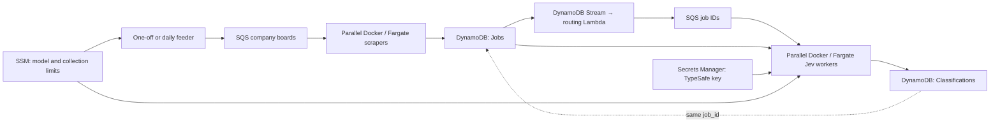

# AWS job pipeline

This CDK application generates a CloudFormation stack containing the complete
collection and Jev classification pipeline. It does not deploy anything merely
by installing dependencies, running tests or synthesizing the template.



Each worker processes one message at a time. The default maximum is four scraper
tasks and two classifier tasks; both services start at zero and scale down to zero
after the queue, including in-flight work, empties. Scaling is metric-driven and
takes several minutes; it is not an immediate task launch for every message.
One short-lived feeder task queues the requested company boards. A Lambda routes
new jobs and title/description changes to classifiers. Refreshing only
`last_seen` does not trigger more paid classifications.

Docker is appropriate here: one reproducible image supplies the feeder and both
worker types. Fargate manages the machines; there are no EC2 hosts to maintain,
no inbound ports and no load balancer. Tasks use public subnets with public IPs
for outbound employer/API access. Their security group has no inbound rules.
There is no NAT gateway; running tasks still incur public IPv4 charges.

## Deploy

Requirements: Python 3.12+, uv, Node.js 22+ (24 recommended), npm, Docker with
BuildKit, and an authenticated AWS account with permission to bootstrap CDK and
create this stack. ECS Fargate and Docker assets target Linux x86-64, including
when deploying from an ARM laptop. Docker must be running during deployment.

From the repository root, select your own account/profile and region, for example:

```sh
export AWS_PROFILE=my-profile
export AWS_DEFAULT_REGION=eu-west-3
uv sync --locked --group infra
npm ci
npx cdk bootstrap
npm run synth
npm run diff
npm run deploy
```

Bootstrapping is required once per account/region and creates CDK's asset bucket
and ECR repository. Deployment builds and uploads the Docker image automatically.
The stack creates two new tables with generated names; it does not adopt or
migrate earlier manually created tables. Resource names, queue URLs and helper
settings are CloudFormation outputs.

No API key is passed to CDK or CloudFormation. By default the stack creates an
**empty** Secrets Manager secret. The services start at zero and the daily
schedule is disabled, so populate the key before queuing any jobs:

```sh
uv run python -m infra.manage set-key --region eu-west-3
```

The helper prompts without echoing the key and sends it directly to Secrets
Manager. It does not place it in a file, shell history or command-line argument.
The secret must contain the raw API key as a plain string, not a JSON object.
Only the classifier's ECS execution role can retrieve/inject it; scrapers and the
feeder cannot read it. Runtime AWS access uses separate IAM task roles, not static
AWS credentials. The deployment/operator identity needs CloudFormation
`DescribeStacks`, Secrets Manager `DescribeSecret` and `PutSecretValue` for the
key, and ECS `RunTask` plus `iam:PassRole` for the two seed roles shown in outputs.

If you already have a populated Secrets Manager secret, import its full ARN:

```sh
npm run deploy -- -c typesafeSecretArn=arn:aws:secretsmanager:eu-west-3:123456789012:secret:my-key-abcdef
```

For a customer-managed KMS key, add the execution role's decrypt permission and
the key policy before using an imported encrypted secret. The default stack uses
AWS-managed encryption and needs no custom KMS configuration.

## Start a small run

```sh
uv run python -m infra.manage collect --region eu-west-3 \
  --max-boards 3 --limit 5 --platforms greenhouse lever
```

This starts a feeder task, which queues three boards with up to five postings per
board. Workers wake as the queue metrics arrive. A returned task ARN confirms
launch only: check the feeder's stopped-task exit code, CloudWatch logs, queues
and tables for completion. With no overrides, a run queues the first 100 unique
boards from the shipped directory and collects up to 20 jobs per board. Repeated
runs use directory order; this is not random sampling. Increase the company cap
explicitly to process more of the 12,236 directory rows.

View generated resource names and configuration:

```sh
uv run python -m infra.manage outputs --region eu-west-3
```

Use `--stack` if you deployed with a different CloudFormation stack name, and
`--profile` to override the AWS profile for the helper. The default stack name
is `JobPipeline`.

## Configuration and secrets

| Setting | Storage | Default |
| --- | --- | --- |
| TypeSafe API key | Secrets Manager; injected as `TYPESAFE_API_KEY` | Empty until supplied |
| Jev model | SSM StringParameter; injected as `JEV_MODEL` | `jev-latest` |
| Company-board count per run | SSM StringParameter | 100 |
| Maximum collected jobs per company | SSM StringParameter | 20 |
| Scraper concurrency cap | CDK context `maxScrapers` | 4 |
| Classifier concurrency cap | CDK context `maxClassifiers` | 2 |
| Daily feeder schedule | CDK context `schedule` | false |

SSM Parameter Store is suitable for ordinary settings. An SSM SecureString could
also hold a key, but this stack uses Secrets Manager as the dedicated secret store.
Neither service makes a key safe if it is committed or passed as a CLI argument.

Configure deployment defaults, for example:

```sh
npm run deploy -- -c maxScrapers=6 -c maxClassifiers=2 \
  -c maxBoards=250 -c jobsPerBoard=20 -c jevModel=jev-latest
```

Runtime SSM parameter names are emitted as `JevModelParameter`,
`MaxBoardsParameter`, and `JobsPerBoardParameter`. You can change them through
SSM; redeploying with different CDK context updates the desired values too.
ECS injects values only when a task starts. After a key/model change, force a new
deployment of the classifier service using the emitted cluster/service names, or
allow idle tasks to scale to zero before launching new work. Merely changing a
secret does not update already running containers. Changing the model triggers
reclassification on the next delivery; use local `--force` below when refreshing
an unchanged model alias.

After supplying the key, enable a daily run with:

```sh
npm run deploy -- -c schedule=true
```

A scheduled EventBridge target confirms only that ECS accepted a feeder task.
Check the feeder logs/exit code for failures after task launch. The schedule DLQ
catches target delivery failures, not application failures inside a launched task.

## Data model and filtering

The **Jobs** table contains posting fields directly (`title`, `company`,
`description`, `source`, `board`, and `region`), plus `first_seen`, `last_seen`
and the stable SHA-256 `job_id`. Only scrapers update these records.

The **Classifications** table has the same `job_id` partition key, with top-level
`seniority`, `is_tech`, `category`, `provider`, `model`, `input_hash`,
`schema_version`, `classified_at`, `tech_status`, and `seniority_job`.
Results do not duplicate the full job description. A short-lived lease can leave
an incomplete `job_id`-only row after an unsuccessful first attempt; such a row
is not a completed result and does not appear in the filtering indexes.

Two global secondary indexes allow filtering without scanning all job descriptions:

| Index | Partition key | Sort key |
| --- | --- | --- |
| `ByCategorySeniority` | `category`, e.g. `cloud_engineer` | `seniority_job`, e.g. `senior#<job_id>` |
| `ByTechSeniority` | `tech_status`: `tech`, `non_tech`, or `unknown` | `seniority_job` |

Example in Python (use table names from stack outputs):

```python
import boto3
from boto3.dynamodb.conditions import Key
from backend.jobs.classification.models import classification_input, input_hash

db = boto3.resource("dynamodb", region_name="eu-west-3")
results = db.Table("YOUR_CLASSIFICATIONS_TABLE")
page = results.query(
    IndexName="ByCategorySeniority",
    KeyConditionExpression=Key("category").eq("cloud_engineer")
    & Key("seniority_job").begins_with("senior#"),
)
jobs = db.Table("YOUR_JOBS_TABLE")
for result in page["Items"]:
    job = jobs.get_item(Key={"job_id": result["job_id"]}, ConsistentRead=True).get("Item")
    # Drop missing/stale jobs; source changes can occur after a result was saved.
    if job and result["input_hash"] == input_hash(classification_input(job)):
        print(result["seniority"], job["title"])
# Follow LastEvaluatedKey with ExclusiveStartKey for subsequent result pages.
```

Indexes are eventually consistent. A production API should paginate the index,
batch-get source jobs, and check the input hashes before serving results. No API
or dashboard is deployed by this stack.

## Retries, durability and operations

- SQS is at-least-once. Scrapers upsert stable IDs, so retries do not create duplicate
  job rows. Provider fetches can repeat.
- The jobs stream decouples persistence from classification delivery. The router
  retries failed sequences; its failure queue and alarm expose exhausted delivery.
- Classifiers read the latest job directly by ID. Unchanged successful results are
  skipped. A five-minute DynamoDB lease limits overlapping paid calls.
- A DynamoDB transaction verifies the source still matches the job sent to Jev
  and saves the result only while the worker owns the lease. A source change or
  deletion causes retry; it never writes into the Jobs table or recreates a job.
- SQS visibility is renewed while processing. Messages are deleted only after
  success; after five unsuccessful receives they move to a dead-letter queue.
  ECS shutdown stops polling and permits up to 120 seconds to finish. Work killed
  before acknowledgment is retried after its visibility timeout.
- Jev transient failures get the SDK's bounded retries; SQS retries the job later.
  Invalid jobs or model outputs also reach the DLQ for investigation.
- Duplicate API calls remain possible after a crash between the external call and
  the result write. This is not an exactly-once external billing guarantee.
- Worker logs exclude provider bodies and keys. Queue and routing DLQ alarms are
  created, but no email/SNS subscription is configured; wire alarm actions to your
  monitoring system if notifications are needed.

The jobs stream retains only 24 hours. Routing failure notifications can outlive
the original stream records. Recover missed delivery or reprocess earlier table
contents by queuing a backfill:

```sh
uv run python -m infra.manage backfill --region eu-west-3
```

Backfill scans source IDs and sends messages, but skips paid calls for unchanged
completed results. It can read the whole table and has no per-run classification
budget. To force an unchanged alias refresh or perform a bounded local backfill:

```sh
# Set TYPESAFE_API_KEY securely in this local process first.
uv run python -m backend.jobs.cli.classify \
  --table YOUR_JOBS_TABLE --results-table YOUR_CLASSIFICATIONS_TABLE \
  --aws-region eu-west-3 --limit 100 --force
```

Pause the daily rule before maintenance. Inspect worker DLQs and use SQS redrive
after correcting credentials or provider failures. Deployment changes can restart
workers; avoid deploying during a large run when practical. Deleting a source job
does not automatically delete its result; consumers must ignore orphaned results.
No closed-job reconciliation or cross-provider deduplication is implemented.

## Cost and cleanup

Deployment creates billable AWS resources. Costs include running Fargate tasks,
public IPv4 while running, ECR/S3 assets, Lambda, SQS, DynamoDB on-demand reads,
writes and two GSIs, point-in-time recovery, CloudWatch and Secrets Manager.
TypeSafe usage is billed separately. Scaling to zero avoids idle Fargate compute,
not all infrastructure cost. Worker caps bound concurrency, not total daily calls
or spend, and do not enforce a provider-wide requests-per-minute quota.

`npx cdk destroy` deletes the workers and queues (including queued work) but retains
both data tables and the created API-key secret. These retained resources keep
their costs until you explicitly remove them. Bootstrap assets can also remain.
An imported secret is never owned/deleted by this stack.

## Verification

```sh
uv sync --locked --group infra
npm ci
uv run --locked python -m unittest discover -s backend/tests -v
uv run --locked --group infra python -m unittest discover -s infra/tests -v
uv run --locked ruff check .
uv run --locked ruff format --check .
npm run synth -- --no-lookups
docker build -t job-applier-pipeline:test .
docker run --rm --read-only job-applier-pipeline:test -m backend.jobs.workers.worker --help
```

CDK tests assert the table/index schema, zero-capacity worker services, queue retry
policies, secret injection and IAM separation. Runtime tests exercise queueing,
stream change detection, scrapers through DynamoDB to classification, GSI queries,
leases, stale-source races and retries using Moto and a mocked Jev HTTP transport.
Synth/build tests do not prove a successful AWS deployment or live Jev access.

If your corporate/cloud build proxy intercepts TLS, supply your **trusted PEM CA
bundle** as an optional BuildKit secret, retaining certificate verification:

```sh
docker build --secret id=build_ca,src=/path/to/trusted-ca-bundle.pem \
  -t job-applier-pipeline:test .
# For CDK's Docker asset build:
export PIPELINE_BUILD_CA=/path/to/trusted-ca-bundle.pem
npm run deploy
```

The CA bundle is mounted only for dependency installation, not embedded in the
image. Do not set insecure TLS flags. In a filesystem-restricted cloud session,
point caches at writable directories if necessary, for example
`UV_CACHE_DIR=/workspace/.cache/uv`,
`JSII_RUNTIME_PACKAGE_CACHE_ROOT=/workspace/.cache/jsii`,
`npm_config_cache=/workspace/.cache/npm`, and
`BUILDX_CONFIG=/workspace/.cache/buildx`.
